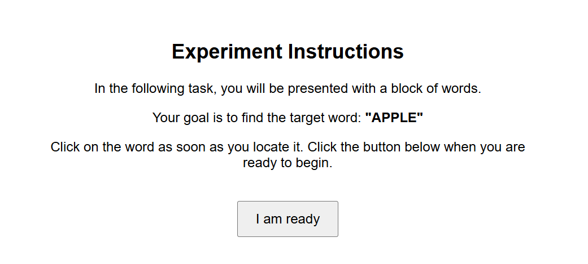
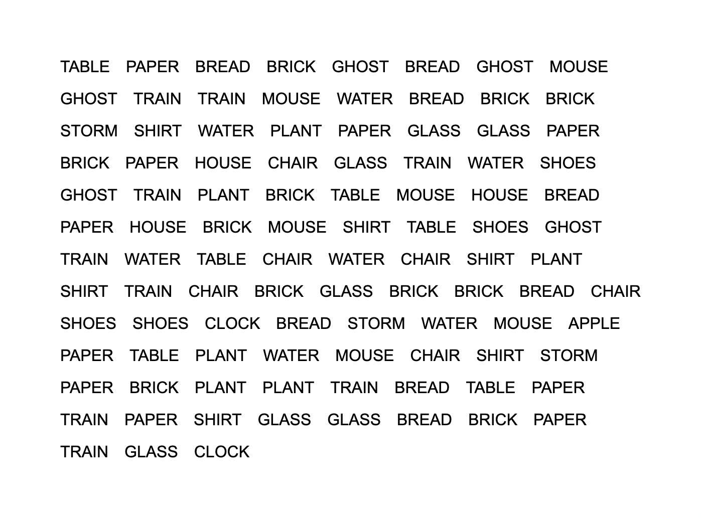
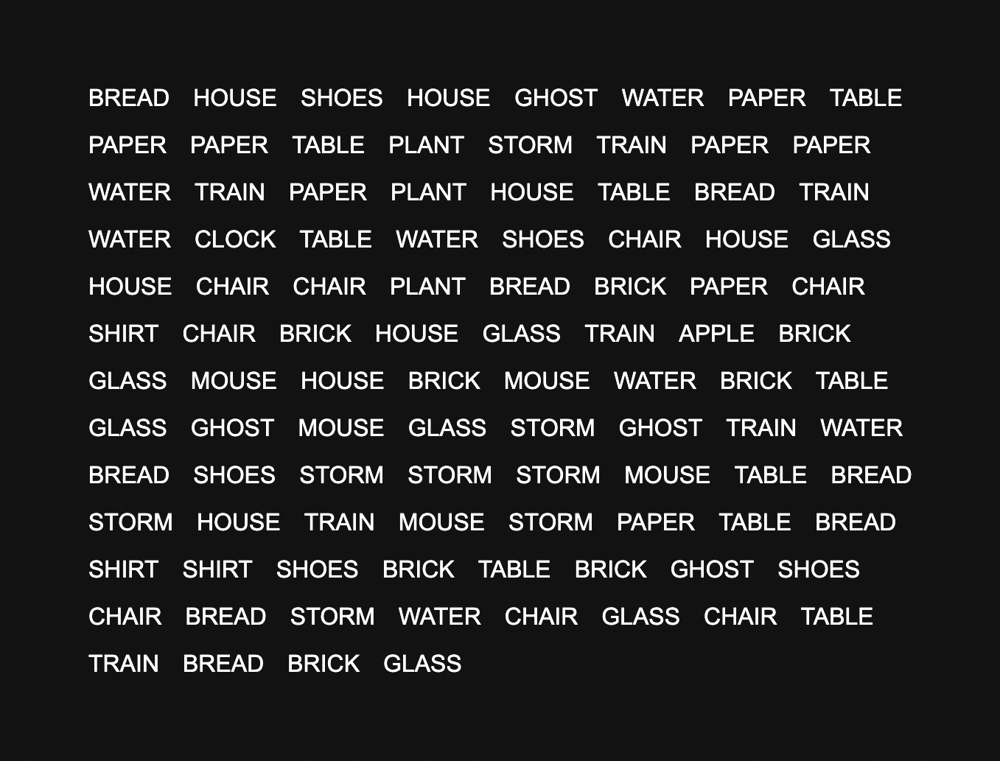
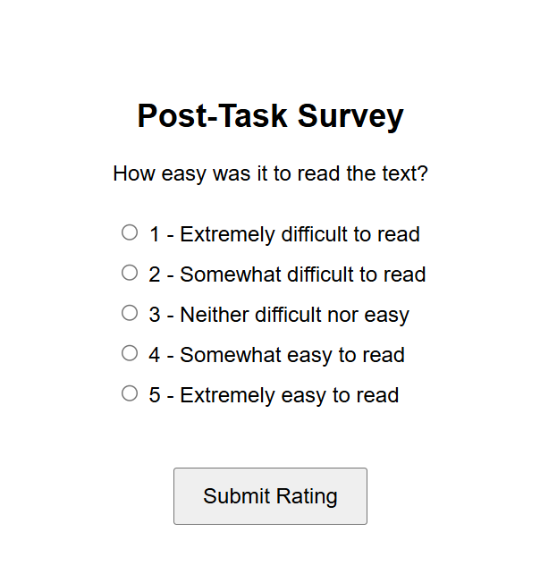

# A/B Experiment: Dark Mode vs Light Mode

This repository contains the statistical analysis of an A/B experiment we did in the EIS course at UPM (2026). The experiment was done in a team of three. I was responsible for the statistical analysis in R and the interpretation of the results. The experiment website was made by Floor van Steijn and can be found here: https://floorvansteijn.github.io/ab-testing-case-study/

## Goal of the experiment

The experiment compares a Dark Mode and a Light Mode version of a website. We wanted to check two things:

1. Does the theme affect how fast a user finds a specific word in a block of text?
2. Does the theme affect how readable the text feels to the user?

Each participant was randomly assigned to only one of the themes (between-subjects design). On the website they had to find and click the word "APPLE" in a grid of 100 words, and after that they rated the readability on a scale from 1 to 5. The search time was saved automatically.

First, the participants saw the instructions:

Then they had to find the word "APPLE" in Light Mode or Dark Mode:

Light Mode:

Dark Mode:

At the end, they rated the readability:

In total 24 people took part, 12 in each group. They were mostly university students, and the data was collected between 21 April and 20 May 2026.

## Search time

The null hypothesis was that there is no difference in the average search time between Light Mode and Dark Mode, and the alternative was that there is a difference (two-sided).

On average, Dark Mode users were 1.44 seconds faster (10.04 s vs 11.48 s). To check whether this is significant, I used a two-sample t-test, with a z-test as an additional check. Before that, I verified the assumptions. The Shapiro-Wilk test showed the data in both groups is normally distributed, and the Levene test showed the variances are equal (p = 0.81), even though the boxplots suggested a bigger spread for Dark Mode.

The t-test gave p = 0.565, so the difference is not statistically significant. I also fitted a simple linear regression with the theme as a predictor, which gave the same p-value and an adjusted R-squared of -0.029. This means the theme explains none of the variance in search time. The residuals of the model are normally distributed.

To see how big the difference is in practice, I calculated Hedges' g, which corrects for the small sample. It is 0.23, a small effect, with a 95% confidence interval from -0.55 to 1.00.

## Perceived readability

The readability was measured on a Likert scale, which is ordinal and not continuous. The difference between "Strongly Agree" and "Agree" is not necessarily the same as between "Agree" and "Neutral". For this reason I used the Wilcoxon rank-sum test instead of a t-test, as it doesn't assume any distribution of the data.

The result was p = 0.97, and both groups have a median rating of 3. The effect size (Cliff's delta) is 0.01, with a confidence interval of [-0.45, 0.43], which is negligible. The theme had no visible influence on how readable the text felt to the participants.

## Conclusions and limitations

We didn't find a significant difference between the themes in either search time or readability. However, this doesn't mean that the themes are exactly the same. With 12 people in each group, the experiment could only detect quite large differences. The confidence interval of Hedges' g is wide and still includes medium effects in both directions. To check whether Dark Mode really makes searching slightly faster, a much larger group would be needed (around 300 people per group for an effect of this size).

Other limitations:
- the participants were mostly students from our network (convenience sampling)
- the experiment was done remotely, so we couldn't control the screen size, brightness or room lighting
- there was only one search task and one question about readability
- we didn't collect participant IDs, so duplicate submissions had to be removed manually before the analysis

## Files

- 'AB Experiment Data Analysis.Rmd' - the whole analysis in R Markdown
- 'AB-Experiment-Data-Analysis.pdf' - knitted analysis with all outputs
- 'Experiment_Data.csv' - anonymised data (timestamp, theme, search time, rating)
- 'AB Experiment Report.pdf' - final report of the team
- 'images/' - screenshots of the experiment website
- 'Spreadsheet' - link to the Google Sheets where the experiment data was automatically collected

To run the analysis, install the packages 'dplyr', 'effectsize' and 'car' and knit the Rmd file in RStudio.

